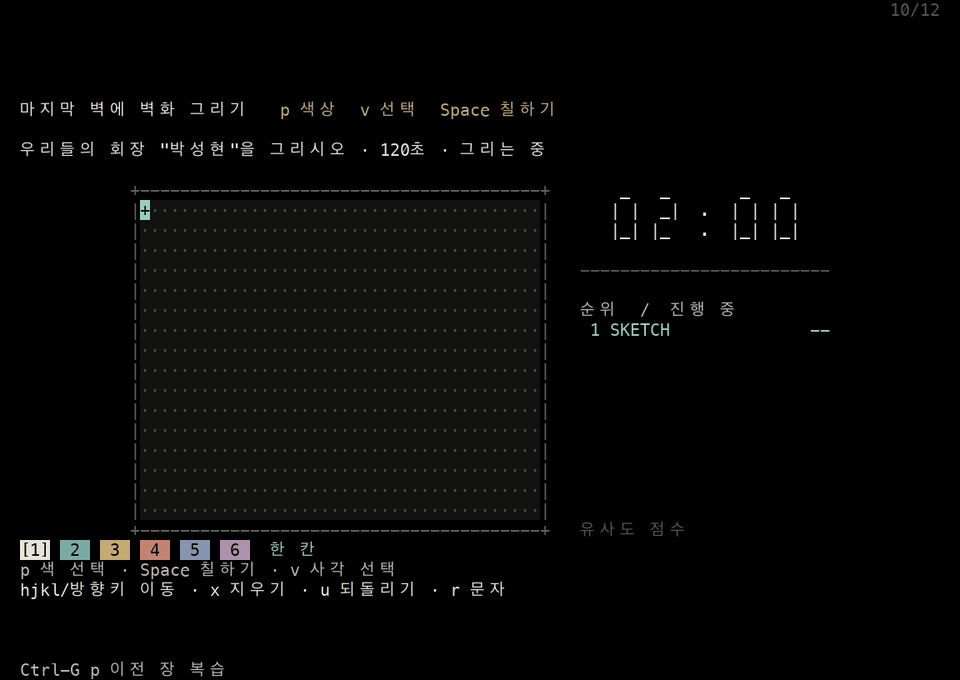

# 너도 이제, Be Vim

**Vim에서 아직도 못 빠져나오고 계신가요?**

SSH로 접속해서 함께 듣는 15분짜리 Vim 입문 세미나입니다. 발표자가 장을 넘기면 모두의 터미널에 같은 슬라이드가 펼쳐집니다. 쌀알 물고기가 헤엄치는 문자 화면에서 각자 패들을 움직이고, 벽의 균열을 찾고, 마지막에는 SCSC 회장의 초상화를 그립니다. 참가자는 SSH 클라이언트만 있으면 됩니다.



## 내 컴퓨터에서 열기

서버에는 uv, Python 3.12 또는 3.13, PATH에서 실행 가능한 Neovim(nvim)이 필요합니다. macOS에서는 다음과 같이 시작합니다.

```sh
brew install uv neovim
git clone https://github.com/yoonhero/vim-seminar.git
cd vim-seminar
uv sync --locked --python 3.12
uv run be-vim
```

시작할 때 발표자 비밀번호를 정합니다. 첫 실행에서는 SigLIP 2 모델을 내려받으므로 행사 전에 한 번 실행해 두세요. 기본 글꼴은 macOS의 Menlo입니다. 다른 운영체제에서는 `--font`에 설치된 고정폭 글꼴 파일 경로를 지정하세요.

서버를 켜 둔 채 터미널 창 두 개에서 각각 접속하면 발표자와 참가자 화면을 함께 확인할 수 있습니다.

| 역할 | 접속 명령 | 입장 후 |
| --- | --- | --- |
| 발표자 | `ssh -p 2222 presenter@localhost` | 시작할 때 정한 비밀번호 입력 |
| 참가자 | `ssh -p 2222 guest@localhost` | 현재 장에 입장. 이름은 두 번째 장에서 입력 |

기본 서버는 루프백 주소에서 열립니다. 같은 네트워크에서 진행할 때는 서버를 `uv run be-vim --bind 0.0.0.0`으로 실행하고 접속 명령의 `localhost`를 발표자 컴퓨터의 LAN 주소로 바꾸세요. 화면은 창 크기에 맞춰 배치되며 80열 × 24행 이상을 권장합니다.

## 발표 진행표

| 장 | 참가자가 하는 일 | 익히는 키 |
| --- | --- | --- |
| 1–2 · 입장 | 표지에서 시작해 벽에 닉네임 새기기 | `i`, 이름, `Enter` |
| 3 · 벽돌깨기 | 공을 받아 벽돌을 깨고 다음 판으로 이어가기 | `h j k l`, `Space` |
| 4–5 · 이동 | 미로에서 균열까지 이동하고 단어 발판의 양 끝에 착지하기 | 숫자 + 방향, `w b e` |
| 6 · 찾기 | 같은 줄의 균열을 찾고 다음 검색 결과로 건너가기 | `f*`, `;`, `/crack`, `n` |
| 7–8 · 선택과 복제 | 벽의 표식을 선택하고 철거 표시를 복제하거나 되돌리기 | `v`, `Ctrl-v`, `r#`, `y p u` |
| 9 · 수정 | 잘못 새긴 표식을 지우고 같은 수정을 반복하기 | `dw`, `ciw`, `.` |
| 10 · 벽화 | **우리들의 회장 "박성현"을 그리시오** | 아래 캔버스 조작표 참고 |
| 11–12 · 공개 | 함께 작품을 보고 관객상에 투표한 뒤 최종 순위 확인하기 | `v` 투표, `Ctrl-C` 종료 |

발표자도 각 장에서 직접 플레이할 수 있습니다. 참가자의 입력과 진행도는 개인별로 유지됩니다. 뒤늦게 들어온 참가자도 이전 장을 연습하다 발표에 다시 합류할 수 있습니다.

| 진행 동작 | 키 |
| --- | --- |
| 발표자가 다음 장 / 이전 장으로 이동 | `PageDown` / `PageUp` 또는 `Ctrl-G` 후 `n` / `p` |
| 참가자가 지난 장 복습 / 발표에 즉시 합류 | `Ctrl-G` 후 `p` / `l` |
| 그림 라운드 시작 / 갤러리에서 다음 공개 | 발표자가 `F5` / `F6` 또는 `Ctrl-G` 후 `s` / `r` |

## 그림 라운드

40 × 16칸의 문자 캔버스에서 모두가 동시에 그립니다. `hjkl`로 이동하고 `Tab`으로 다음 색을 고릅니다. 원하는 색으로 바로 가려면 `p`를 누른 뒤 `1`–`6` 중 하나를 누르세요. 한 칸은 `Space`, 사각형은 `v` → 반대쪽 모서리로 이동 → `Space`로 칠합니다. `x`는 지우기, `u`는 되돌리기입니다.

기본 제한 시간은 120초입니다. 마지막 30초에는 공개 순위표가 멈추고 그림은 계속 편집할 수 있습니다. 마감 후 서버가 최종 그림을 채점하고 발표자가 갤러리에서 한 작품씩 공개합니다. SigLIP 2 점수는 ‘사람의 ASCII 초상화’라는 설명과 그림의 유사도입니다. 회장의 실제 얼굴과 얼마나 닮았는지는 관객이 작품을 보며 판단하고 투표할 수 있습니다.

## 개발과 리허설

```sh
uv run python -m unittest discover -s tests
uv run ruff check be_vim tests
uv run python tests/smoke_full_flow.py
```

마지막 명령은 로컬 SSH 세션으로 발표 진행부터 그림 마감과 공개까지 재현합니다. 앱 진입점은 [app.py](be_vim/app.py), 발표 순서는 [slides.py](be_vim/slides.py), 세션 간 공유 상태는 [room.py](be_vim/room.py)에서 확인할 수 있습니다.

시간을 줄여 리허설하려면 `uv run be-vim --duration 45 --freeze 10`으로 실행하세요. SSH 호스트 키와 라운드별 그림·점수는 기본적으로 로컬 `var/`에 저장됩니다. 같은 주소에서 재실행할 때는 참가자가 기존 서버를 확인할 수 있도록 호스트 키를 보관하세요.
